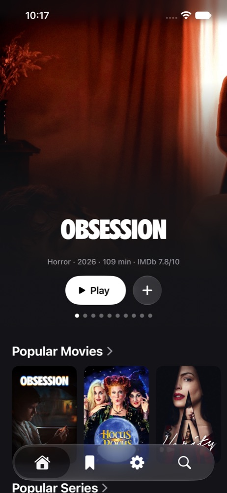

# loge — Stremio client for iOS, tvOS and macOS

A native SwiftUI client for Stremio addons on iPhone, iPad, Apple TV and Mac. Browse
movie and TV catalogs, track episodes and play direct video streams with mpv.

[Install](#installing) · [First run](#first-run) · [Accounts and sync](#optional-accounts) ·
[Troubleshooting](#troubleshooting) · [Build from source](#building)

Requires **iOS/iPadOS 26**, **tvOS 27** or **macOS 27 on Apple silicon**.

Movies, series, search and IMDb ratings work out of the box through Cinemeta. To watch
something, add a Stremio addon that provides streams. **loge has no content of its own**:
what plays, and whether you may watch it, depends entirely on the addons you add.

## What it does

- **Home:** popular and Letterboxd lists, genres, festival winners and directors, Continue
  Watching, Watch Later and your own lists.
- **Details:** seasons and episodes with Up Next, cast and crew, reviews, and marking
  things watched. History lists everything you played, by day.
- **Sources:** every stream from your addons, read into resolution, HDR, codec, audio,
  size and bitrate. The best one your connection keeps up with is marked as recommended.
- **Player:** mpv with hardware decoding, HDR, Picture in Picture, AirPlay, subtitles from
  the file, the stream or subtitle addons (with timing adjustment), skipping of intros,
  recaps and credits, and the next episode starting by itself.
- **Accounts, both optional:** [Trakt](https://trakt.tv) brings in paused playback progress
  and receives playback and watched-history updates; a [TMDB](https://www.themoviedb.org)
  token adds metadata, portraits, filmographies and member reviews.
  See [what syncs](#trakt-playback-progress) before setting up a second device.

Only direct HTTP(S) streams play. Torrents and magnet links are not supported.



## Installing

loge isn't in the App Store. You sign it yourself with a free Apple ID; no paid developer
account is needed.

### iPhone and iPad: iloader (works now)

Since October 2026, SideStore and AltStore can't sign in to Apple from the phone (error
`-80045`) after a change on Apple's servers. Until they're fixed, sign loge from a computer:

1. Download `loge-iOS.ipa` from the
   [latest release](https://github.com/timhlzwrt/loge/releases/latest).
2. Open [iloader](https://iloader.app) on a Mac, Windows or Linux computer, sign in with your
   Apple ID and plug in the phone.
3. Choose **Import IPA** and pick the downloaded file.

The free signature lasts 7 days: import again each week, which also brings you the newest
build. If iloader says the maximum number of certificates is reached, revoke only ones you
don't use elsewhere; apps signed with a revoked certificate stop opening.

### iPhone and iPad: SideStore (once its sign-in works again)

1. Set up [SideStore](https://sidestore.io) once, following its guide.
2. In SideStore, open **Sources**, tap **+** and add:

   ```
   https://tjh.li/loge/source.json
   ```

3. Install loge from the source. New builds appear there as updates. SideStore refreshes
   the 7-day signature in the background.

The same source works in [AltStore](https://altstore.io) Classic.

### Apple TV

SideStore doesn't run on tvOS. Download `loge-tvOS.ipa` from the
[latest release](https://github.com/timhlzwrt/loge/releases/latest) and install it with a
computer-based sideloader such as [Sideloadly](https://sideloadly.io). The free signature
lasts 7 days, so reinstall or refresh it each week.

### Building your own (with a Mac and Xcode)

With Xcode signed in to your Apple ID, `Tools/install.sh` builds loge and installs it on a
connected iPhone, iPad or, through [atvloadly](https://github.com/bitxeno/atvloadly) (set
`ATVLOADLY` to its address), an Apple TV. Xcode's own signing isn't affected by the sign-in problem above.

### Mac

Needs macOS 27 on Apple silicon.

1. Download `loge-macOS.dmg` from the
   [latest release](https://github.com/timhlzwrt/loge/releases/latest), open it and drag
   **loge** to **Applications**.
2. Open loge. macOS refuses the first time, since the app is ad-hoc signed rather than
   notarized by Apple; click **Done**.
3. Open **System Settings → Privacy & Security**, scroll to the message about loge and click
   **Open Anyway**, then confirm with your password.

That's needed once per download. For updates, download the newest `.dmg` and replace the app.

### Which build do I have?

Settings → About shows the build's commit and date, with a link that compares it with the
latest `main` on GitHub. Every push to `main` becomes a
[release](https://github.com/timhlzwrt/loge/releases) numbered by commit count.

## First run

1. Open **Settings → Addons**. Cinemeta supplies the built-in movie and series catalogs;
   playback needs an addon that provides streams.
2. In **Add addon**, paste the addon's configured **Manifest URL** ending in
   `/manifest.json`, then select **Install**. Use the manifest URL, rather than the
   addon's configuration webpage.
3. Open a title, choose an episode for a series, then select **Sources** and a playable
   stream. The app remembers your selected source for subsequent playback when available.
4. On another device, install the addon there too, or connect your own server in
   **Settings → Sync** to share addon setup and preferences.

Addons higher in **Your addons** are asked first. Use **Edit** to reorder on iPhone/iPad,
drag rows on Mac, or open an addon's menu and choose **Move Up** / **Move Down** on Apple TV.

## Optional accounts

Browsing and playback do not require a loge account. Trakt and TMDB are separate optional
connections, configured in Settings on each device.

### Trakt playback progress

1. Create your own application at [Trakt applications](https://trakt.tv/oauth/applications)
   with redirect URI `urn:ietf:wg:oauth:2.0:oob`.
2. In **Settings → Trakt**, enter its **Client ID** and **Client Secret**, then **Save**.
3. Select **Sign In**, open the displayed verification URL and enter the displayed code.
4. Sign in to the same Trakt account on each device. Use **Sync Now** to request paused
   progress manually.

loge pulls paused movie and episode progress on launch and when returning to the app, and
sends playback scrobbles and watched/unwatched changes to Trakt. Recent completed plays
clear unfinished local entries, keeping their original watch dates. Newer local progress
takes precedence when merging.
Matching requires IMDb identifiers; titles known only by another addon's identifiers may
not sync. New titles use built-in Cinemeta or a matching installed metadata addon.

**Trakt scope:** Watch Later, custom lists, addon setup, source selections and settings
are not carried by Trakt. Trakt's full watched history is not imported. There is no offline
upload queue, so failed updates are not stored for later delivery. A Trakt connection is
not a complete backup of your library or configuration.

### Addon and settings sync

**Settings → Sync** optionally connects to your own HTTPS CouchDB sync endpoint.
There is no default server. Share ordered addons, audio/subtitle preferences,
subtitle size, automatic source size limit and accent across your devices.
Configurations are encrypted on-device; credentials and the recovery key stay in
Keychain. A setup code connects additional devices, including Apple TV. See the
[setup and self-hosting guide](docs/CONFIGURATION_SYNC.md) for deployment, conflict
handling and recovery-key precautions.

### TMDB metadata

Open **Settings → TMDB → Connect TMDB**, paste the **API Read Access Token** from your
[TMDB API settings](https://www.themoviedb.org/settings/api) and select **Connect**. This is
the read access token, rather than the API key. The app checks it before saving it in the
device's Keychain. On Apple TV, use the Apple TV Remote keyboard on your phone to enter it.

## Troubleshooting

- **Catalogs load, but no sources appear:** install a playback addon in Settings → Addons.
  Check that its configuration provides streams for the selected title and that the addon
  is reachable. Built-in catalog results do not guarantee an available stream.
- **A source is unsupported:** only direct HTTP(S) video streams play. Torrent files,
  info hashes and magnet links require an addon/service that supplies a direct video URL.
- **Playback buffers:** try a smaller source or lower bitrate. The source list shows size
  and bitrate when available, and recommends a source when it has a measured
  connection speed to compare against. A new device may not yet have that measurement.
- **Continue Watching differs between devices:** check the same Trakt account is connected
  on both, pause or close playback on the first, then select **Sync Now** on the second.
  See the [sync limits](#trakt-playback-progress), including unsupported title identifiers.
- **A sideloaded app stops opening after a week:** refresh or reinstall its signature using
  your sideloading tool. Free Apple ID signatures expire after seven days.

For a reproducible problem, [open an issue](https://github.com/timhlzwrt/loge/issues) with
the device and OS version, the commit from **Settings → About**, steps to reproduce and
what you expected. Include a screenshot when useful. Redact addon manifest URLs, access
tokens, Trakt app secrets and stream URLs containing credentials; an addon host and name
are enough to identify the provider.

## Building

Needs Xcode 27 and [XcodeGen](https://github.com/yonaskolb/XcodeGen).

```sh
xcodegen generate              # after adding or removing files
(cd Core && swift test)        # Core unit tests
xcodebuild -project loge.xcodeproj -scheme loge \
  -destination 'generic/platform=iOS Simulator' -derivedDataPath .build/xcode build
```

Swap the destination for `generic/platform=tvOS Simulator` or `platform=macOS`.
`Tools/build-ipa.sh` writes unsigned `.ipa` files to `.build/ipa`, `Tools/build-dmg.sh` the
Mac `.dmg` to `.build/dmg`, and
`Tools/test-addon.py` serves a local addon with test streams at
`http://127.0.0.1:8765/manifest.json`.

| Path             | What's in it                                                        |
| ---------------- | ------------------------------------------------------------------- |
| `Core/`          | `LogeCore` package: addon client, routing, addon and library stores |
| `App/Browse/`    | Home, catalog rows, details, sources, search                        |
| `App/Player/`    | mpv player, controls, Picture in Picture, next episode              |
| `App/Settings/`  | Addons, accounts, playback preferences, About                       |
| `Vendor/MPVKit/` | MPVKit with a patched libmpv that adds an AVFoundation video output |
| `Tools/`         | Test addon, `.ipa` builder, device install scripts, icon renderer   |

[The app overview](docs/APP_OVERVIEW.md) covers data flow and platform behaviour, and
[playback performance](docs/PLAYBACK_PERFORMANCE.md) the source size limits and diagnostics.

## Licence

loge is licensed under the [GNU General Public License v3.0](LICENSE).

Playback uses [mpv](https://mpv.io) and [FFmpeg](https://ffmpeg.org) through
[MPVKit](https://github.com/mpvkit/MPVKit)'s LGPL build (1.1.0-n9.0.2, mpv 0.41.0), under
the LGPL. The patches applied to libmpv and the script that rebuilds it from MPVKit's
source are in [`Vendor/MPVKit`](Vendor/MPVKit). Data sources and
image credits are listed in the app under Settings → About → Data Sources. This product uses
the TMDB API but is not endorsed or certified by TMDB.
