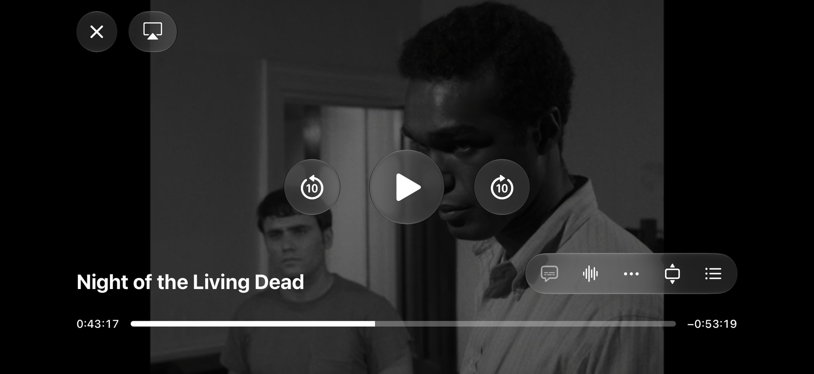

<p align="center">
  
</p>

<p align="center">
  A native Stremio addon client for <strong>iPhone, iPad, Apple TV and Mac</strong>.<br>
  Browse films and series, choose a source, and play it with mpv.
</p>

<p align="center">
  <a href="https://github.com/timhlzwrt/loge/releases/latest"><strong>Download</strong></a> ·
  <a href="docs/INSTALLATION.md">Install</a> ·
  <a href="ROADMAP.md">Roadmap</a> ·
  <a href="CONTRIBUTING.md">Contribute</a>
</p>



Your addons provide the streams. loge doesn't host, bundle or sell content; only use
sources you are entitled to access. loge plays direct HTTP(S) streams only: no torrents,
and no downloads.

## Install

loge is pre-1.0 and not in the App Store. It needs iOS, iPadOS, tvOS or macOS 26.

- **iPhone / iPad:** sideload `loge-iOS.ipa`, or add the SideStore source.
- **Apple TV:** sideload `loge-tvOS.ipa` with atvloadly or Sideloadly.
- **Mac:** open `loge-macOS.dmg` (Apple silicon, not notarized; updates through Sparkle).

Then add your addon's `manifest.json` URL in **Settings → Addons**. The
[installation guide](docs/INSTALLATION.md) covers signing, updates and troubleshooting.
Sync between your devices is optional and self-hosted: see [docs/SYNC.md](docs/SYNC.md).

## Build

```sh
xcodegen generate
(cd Core && swift test)
xcodebuild build -project loge.xcodeproj -scheme loge -destination 'generic/platform=iOS Simulator'
```

[CONTRIBUTING.md](CONTRIBUTING.md) has the full checks, and
[docs/APP_OVERVIEW.md](docs/APP_OVERVIEW.md) explains how the app is put together.

## Licence

[PolyForm Noncommercial 1.0.0](LICENSE). Playback uses [mpv](https://mpv.io) and
[FFmpeg](https://ffmpeg.org) through the LGPL build of [MPVKit](https://github.com/mpvkit/MPVKit)
([patches](Vendor/MPVKit)); Mac updates use [Sparkle](https://sparkle-project.org)
([licence](Vendor/Sparkle-LICENSE.txt)). This product uses the TMDB API but is not endorsed
or certified by TMDB. loge is an independent project, not an official Stremio application.
