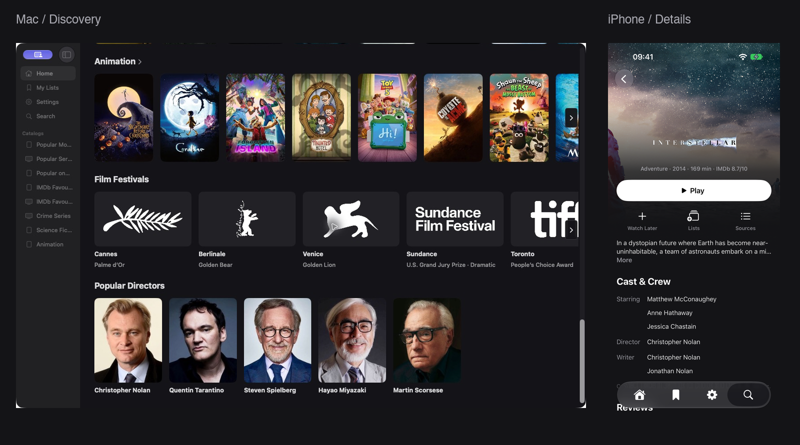
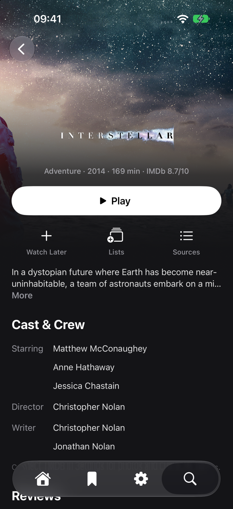
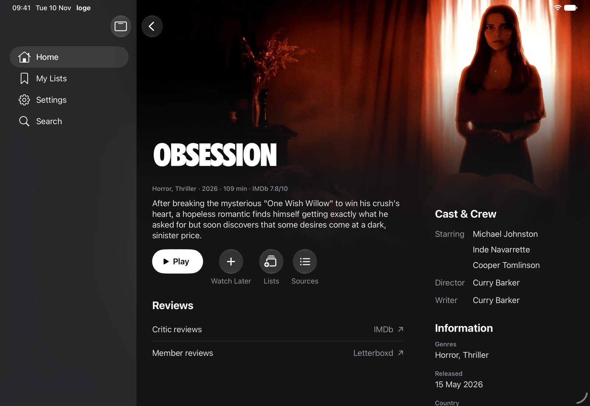

<p align="center">
  
</p>

<p align="center">
  A SwiftUI Stremio addon client for <strong>iPhone, iPad, Apple TV and Mac</strong>.<br>
  Browse films and series, choose your source, and play with mpv.
</p>

<p align="center">
  <a href="https://github.com/timhlzwrt/loge/releases/latest"><strong>Download</strong></a> ·
  <a href="docs/INSTALLATION.md">Install & set up</a> ·
  <a href="#features">Features</a> ·
  <a href="ROADMAP.md">Roadmap</a> ·
  <a href="CONTRIBUTING.md">Contribute</a>
</p>



**Your addons provide the streams.** Cinemeta supplies built-in movie and series
catalogs, search and IMDb ratings. Add a playback addon to watch. loge does not
host, bundle or sell content; only use sources you are entitled to access.

## Platforms

- **iPhone:** iOS 26.0 or later. Portrait browsing, landscape playback.
- **iPad:** iPadOS 26.0 or later. Adaptive browsing and full-screen playback.
- **Apple TV:** tvOS 26.0 or later. Focus-driven browsing and Siri Remote controls.
- **Mac:** macOS 26.0 or later. Sidebar navigation, a separate player window and
  signed in-app updates. The distributed build is for Apple silicon.

These are the deployment minimums for this source revision, not the SDK version
used to build it. The inspected **`build-97`** downloads still require **tvOS 27**
and **macOS 27**; newly built binaries use the corrected OS 26 targets.
[Requirements and verification](docs/REQUIREMENTS.md) explains the API floor,
binary dependencies and what has—and has not—been tested on OS 26.

## Features

### Find something worth watching

- **Artwork-led Home:** popular films and series, IMDb favourites, Letterboxd
  lists, genres, festival winners and directors.
- **Title details:** seasons, episodes, Up Next, cast and crew, watched actions,
  and IMDb ratings with their source and scale.
- **People and festivals:** TMDB-backed portraits and filmographies, role
  filters, member reviews, and dated festival editions with award filters.
  TMDB features require your own read access token.
- **Recommendations:** with a TMDB token, "More Like This" on titles and a Recommended row on
  Home built from what you watched and saved. TMDB supplies the suggestions and
  the ranking happens on your device; TMDB sees only the title lookups.
- **Your library:** Continue Watching, Watch Later, custom lists and history
  grouped by day. Search includes recent queries.

### Choose a source, not a mystery filename

- Streams from installed addons, grouped by resolution with HDR, codec, audio,
  file size and bitrate parsed when the provider supplies them.
- Remembered source selection, automatic fallback and a connection-aware
  recommendation once the device has measured playback download speed.
- A configurable size limit for automatic series-source selection; the default
  is **50 GB per episode**. Movies and manual selections are unrestricted.

### Play with mpv

- Hardware decoding and an AVFoundation video output, with HDR support dependent
  on the device, display and source.
- Embedded and external subtitles, subtitle addons, preferred audio/subtitle
  languages, subtitle sizing, and audio/subtitle timing adjustment.
- Timeline previews, playback speed, chapter/community-based intro, recap and
  credits skips when timing data is available, and an automatic next episode.
- Picture in Picture where supported, system Now Playing controls, an iOS
  AirPlay audio route picker, and Apple TV frame-rate/dynamic-range matching.

Hardware-sensitive features are implemented, not a promise of every codec,
display or output combination. See [limitations](#know-the-limits) and the
[testing scope](ROADMAP.md#a-note-from-the-maintainer).

### Continue on your other devices

**Self-hosted sync** carries movie/episode progress, watched state, ordered addons
and preferences between your devices. Separate accounts can share selected setup
categories without sharing viewing progress. Payloads are encrypted on-device;
there is **no default hosted service**. [Set up private sync →](docs/SYNC.md)

**Trakt** is an alternative for paused progress, playback scrobbling and
watched/unwatched updates. It is paused while a self-hosted account is connected,
so two services do not compete over your watch activity.
[Connect Trakt or TMDB →](docs/INSTALLATION.md#optional-accounts)

**What stays local:** Watch Later, custom lists and remembered stream selections
are not synchronized by either service. Trakt does not carry addon configuration
or preferences and does not import your full watched history. Both services keep
changes made offline on the device and send them on reconnect.

## Install and start watching

loge is **pre-1.0**, not in the App Store, and distributed through
[GitHub Releases](https://github.com/timhlzwrt/loge/releases).

- **iPhone / iPad:** download `loge-iOS.ipa` and sign it with a sideloading tool
  such as [iloader](https://github.com/nab138/iloader). A SideStore / AltStore
  Classic source is also available in the [installation guide](docs/INSTALLATION.md).
- **Apple TV:** download `loge-tvOS.ipa` and install with a tvOS-capable tool such
  as [atvloadly](https://github.com/bitxeno/atvloadly) or
  [Sideloadly](https://sideloadly.io).
- **Mac:** download `loge-macOS.dmg` and drag loge into Applications. The app is
  self-signed, **not notarized**; the first launch needs macOS's **Open Anyway**
  approval. Later updates are verified by Sparkle.

A free Apple ID can sign the iOS/tvOS builds; those signatures need refreshing
every seven days. Mac installation does not use that seven-day signing cycle.
Follow the [platform-specific instructions](docs/INSTALLATION.md) for signing,
Gatekeeper, updates and troubleshooting.

**First run:** open **Settings → Addons**, install your provider's configured
`/manifest.json` URL, open a title, and choose **Sources**. Built-in catalogs do
not imply that a playable source is available. No loge, Trakt or TMDB account is
required for basic browsing and playback.

## Screenshots

<p align="center">
  
  &nbsp;
  
</p>

Real app captures, not UI mockups. The overview combines a Mac discovery capture
with iPhone title details.



[Full-size images and capture notes →](docs/screenshots/README.md)

## Know the limits

- **Direct HTTP(S) streams only.** No torrent engine, info-hash playback or magnet
  support. An addon/service must turn those into a playable video URL.
- **No offline downloads.** Streaming is the playback model; downloads are out of scope.
- **No subtitles in Picture in Picture.** The current subtitle layer is separate
  from the video layer captured by PiP.
- **No Apple TV Top Shelf extension.** Continue Watching inside the app works;
  system Home Screen integration is on hold.
- **English interface only.** Audio and subtitle language preferences are separate.
- **Recommendations need a TMDB token.** Without one, Home has only its discovery
  feeds. Letterboxd links/lists do not mean Letterboxd ratings or account sync
  are integrated.

### Testing scope

**A note from the maintainer:** I don't have the time to carry out real-device testing,
so it isn't planned or required for releases. Testing focuses on iPhone, iPad and
Apple TV simulators, alongside automated tests and Mac builds.

Simulator results aren't hardware certification: HDR output, HDMI display matching,
physical Siri Remote gestures and actual screen-lock recovery remain unverified by
this testing process. They aren't pending roadmap tasks.

The [roadmap](ROADMAP.md) separates shipped work, simulator coverage and proposed
features. Report reproducible problems through the
[issue forms](https://github.com/timhlzwrt/loge/issues/new/choose)—never include
configured addon URLs, stream credentials, connection codes or recovery keys.

## Build from source

These instructions are verified with **Xcode 27.2 / Swift 6.4.2** and
[XcodeGen](https://github.com/yonaskolb/XcodeGen), in Swift 6 language mode.
The app needs OS 26-era APIs; the oldest working Xcode version has not been
established. Older toolchains are not verified; the runtime target remains OS 26.

```sh
git clone https://github.com/timhlzwrt/loge.git
cd loge
xcodegen generate
(cd Core && swift test)
xcodebuild build -project loge.xcodeproj -scheme loge \
  -destination 'generic/platform=iOS Simulator' \
  -derivedDataPath .build/xcode SWIFT_TREAT_WARNINGS_AS_ERRORS=YES
```

For Apple TV use `generic/platform=tvOS Simulator`; for Mac use `platform=macOS`.
Initial builds download the vendored MPVKit binary dependencies. See
[Contributing](CONTRIBUTING.md) for all checks, fixture-based UI tests and packaging.

### Project guides

- [Architecture and data flow](docs/APP_OVERVIEW.md)
- [Platform requirements and verification](docs/REQUIREMENTS.md)
- [Installation, accounts and troubleshooting](docs/INSTALLATION.md)
- [Private sync and shared setups](docs/SYNC.md)
- [Playback diagnostics and performance](docs/PLAYBACK_PERFORMANCE.md)
- [Mac updater signing and publishing](docs/MAC_UPDATES.md)
- [CI](https://github.com/timhlzwrt/loge/actions/workflows/ci.yml) ·
  [Release workflow](https://github.com/timhlzwrt/loge/actions/workflows/release.yml)

## Licence and credits

loge is [GPL-3.0](LICENSE). Playback uses [mpv](https://mpv.io) and
[FFmpeg](https://ffmpeg.org) through the LGPL build of
[MPVKit](https://github.com/mpvkit/MPVKit) (1.1.0-n9.0.2, mpv 0.41.0).
The [vendored patches and rebuild instructions](Vendor/MPVKit) are included.
Mac updates use [Sparkle](https://sparkle-project.org), with its
[licence and third-party notices](Vendor/Sparkle-LICENSE.txt).

Film artwork and metadata belong to their respective owners. Full data-source
and image credits are in **Settings → About → Data Sources**. This product uses
the TMDB API but is not endorsed or certified by TMDB. loge is an independent
project, not an official Stremio application.
