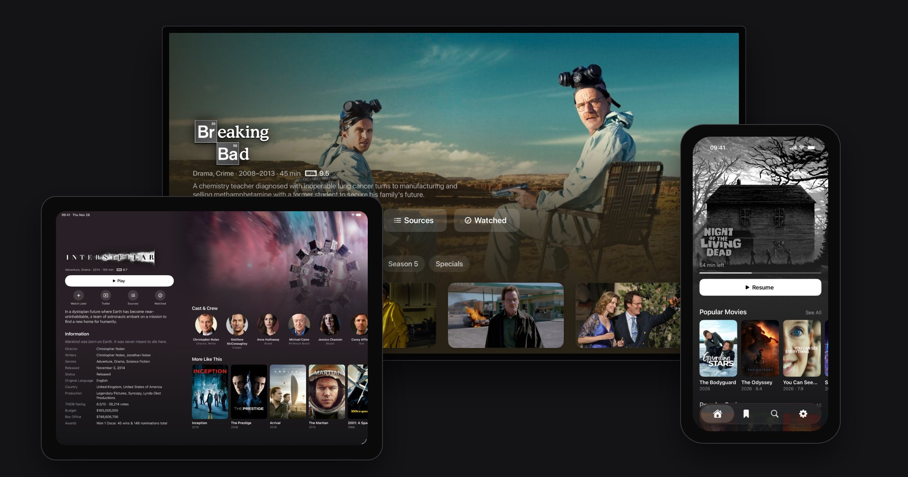
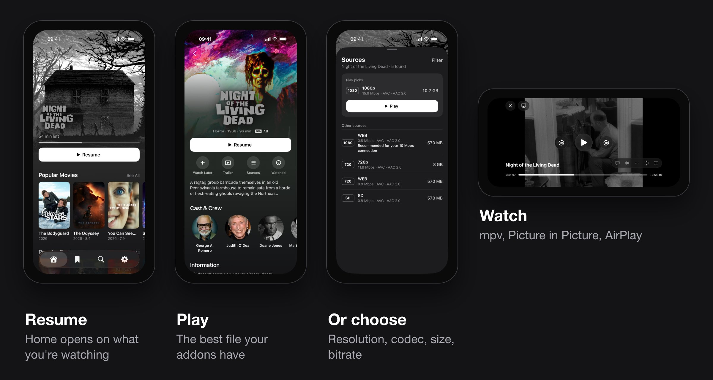

<p align="center">
  
</p>

<p align="center">
  A free, native Stremio addon client for <strong>iPhone, iPad, Apple TV and Mac</strong>.<br>
  Browse films and series, choose a source, and play it with mpv.
</p>

<p align="center">
  <a href="https://github.com/timhlzwrt/loge/releases/latest"><strong>Download</strong></a> ·
  <a href="docs/INSTALLATION.md">Install</a> ·
  <a href="ROADMAP.md">Roadmap</a> ·
  <a href="CONTRIBUTING.md">Contribute</a>
</p>



## What it does

<table>
  <tr>
    <td width="50%" valign="top">
      <strong>Sources, decoded</strong><br>
      Every file your addons find in one list, best first: resolution, codec, audio, size
      and bitrate at a glance. Filter by audio language, HDR or bitrate.
    </td>
    <td width="50%" valign="top">
      <strong>Play picks for you</strong><br>
      Play starts the file that suits your connection and your bitrate limit, remembers
      the release you chose, and moves to the next source if a link dies.
    </td>
  </tr>
  <tr>
    <td valign="top">
      <strong>Series on autopilot</strong><br>
      The next episode from the same release, Skip Intro and Skip Credits where the
      file's chapters mark them, and Up Next counting down. New episodes of the series
      you follow show up in Continue Watching.
    </td>
    <td valign="top">
      <strong>mpv inside</strong><br>
      MKV, HEVC and HLS, hardware-decoded. Embedded and addon subtitles with timing
      control, thumbnails while you scrub, Picture in Picture and AirPlay.
    </td>
  </tr>
  <tr>
    <td valign="top">
      <strong>Apple TV, properly</strong><br>
      Full-screen artwork, the Siri Remote throughout, and the display's frame rate and
      HDR matched to what's playing.
    </td>
    <td valign="top">
      <strong>iPad and Mac</strong><br>
      Two-column title pages on iPad. On the Mac, a Title menu with keyboard shortcuts,
      a full-screen player window and updates through Sparkle.
    </td>
  </tr>
  <tr>
    <td valign="top">
      <strong>TMDB, if you want it</strong><br>
      Cast &amp; Crew, filmographies, film collections, More Like This and a Recommended
      shelf ranked on your device from what you watch and save.
    </td>
    <td valign="top">
      <strong>Your setup, everywhere</strong><br>
      Copy your addons to another device or a friend with one link. Optional sync on
      <a href="docs/SYNC.md">your own server</a>, encrypted on the device, carries
      progress, Watch Later and settings. loge runs no servers of its own.
    </td>
  </tr>
</table>

Your addons provide the streams. loge doesn't host, bundle or sell content; only use
sources you are entitled to access. loge plays direct HTTP(S) streams only: no torrents,
and no downloads.

## Install

loge is still in heavy development and not in the App Store. It needs iOS, iPadOS, tvOS or macOS 26.

- **iPhone / iPad:** sideload `loge-iOS.ipa`, or add the SideStore source.
- **Apple TV:** sideload `loge-tvOS.ipa` with atvloadly or Sideloadly.
- **Mac:** open `loge-macOS.dmg` (Apple silicon, not notarized; updates through Sparkle).

Then add your addon's `manifest.json` URL in **Settings → Addons**. The
[installation guide](docs/INSTALLATION.md) covers signing, updates and troubleshooting.
Sync between your devices is optional and self-hosted: see [docs/SYNC.md](docs/SYNC.md).

## Build

```sh
xcodegen generate
(cd Core && swift test)
xcodebuild build -project loge.xcodeproj -scheme loge -destination 'generic/platform=iOS Simulator'
```

[CONTRIBUTING.md](CONTRIBUTING.md) has the full checks, and
[docs/APP_OVERVIEW.md](docs/APP_OVERVIEW.md) explains how the app is put together.

## Licence

loge is free and source-available under [PolyForm Noncommercial 1.0.0](LICENSE): use it, change it
and share it, but not commercially, so nobody may sell it or build a paid product from it.
Playback uses [mpv](https://mpv.io) and
[FFmpeg](https://ffmpeg.org) through the LGPL build of [MPVKit](https://github.com/mpvkit/MPVKit)
([patches](Vendor/MPVKit)); Mac updates use [Sparkle](https://sparkle-project.org)
([licence](App/ThirdParty/Sparkle-LICENSE.txt)). This product uses the TMDB API but is not endorsed
or certified by TMDB. loge is an independent project, not an official Stremio application.


