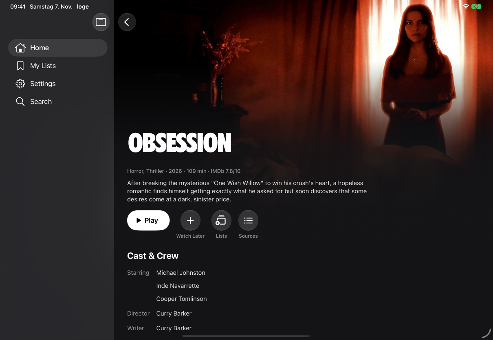
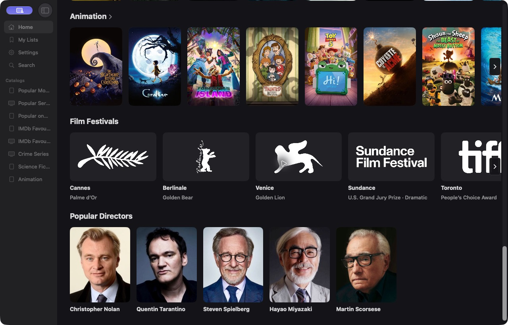

# App screenshots

[Back to loge](../../README.md)

These are real app captures. Film artwork, logos and portraits belong to their
respective owners; the app's **Settings → About → Data Sources** lists credits.
The images demonstrate interface layout, not a guarantee that an addon can
stream a pictured title. None contains configured addon URLs or account secrets.

## iPhone

`iphone-home.jpg` is the existing repository capture of the built-in Home
catalogs. It is retained rather than replaced with a staged library.

`iphone-details.png` was captured on **7 November 2026** from the current Debug
build on an **iPhone 18 Pro simulator / iOS 27.2**, using live catalog metadata.
The status bar was normalized by the capture tool; app content was not altered.

## iPad

`ipad-details.png` was captured on **7 November 2026** on an **iPad Pro 11-inch
(M5) simulator / iPadOS 27.2**, in landscape with live catalog metadata and a
normalized status bar.

## Mac

`mac-discovery.png` is the unaltered **After** portion of the existing
[`mac-shelves-before-after.png`](mac-shelves-before-after.png) capture from
3 November. Its crop rectangle is `(0, 908, 1280, 1728)` in the original image.
It is an earlier Mac browsing capture, not a fresh verification of Mac playback
or the latest sidebar order. Native Mac screenshot access was unavailable for
this documentation pass, so an authentic existing image is used instead.

## README overview

`overview.png` places the Mac crop and current iPhone details capture side by
side on a charcoal background with platform labels. Screens are only resized,
not redrawn. No artificial device frames, playback sources or credentials were added.

## Apple TV

A new tvOS screenshot was not captured in this pass: the connected Device panel
exposes iPhone/iPad simulators, not an Apple TV target. Do not substitute an
iPad/Mac image or a mockup as a tvOS screenshot. Apple TV has a separate
focus-driven layout. The tvOS remote driver (`UITests/RemoteDriverTests.swift`) can
drive the Apple TV simulator for screenshots; see the [roadmap](../../ROADMAP.md).

## Updating these images

- Use public catalog metadata or deterministic fixtures, never private setup fields.
- Show the real affected screen at a readable size. Retain aspect ratio and alt text.
- Strip incidental private data; do not alter feature state to imply unshipped behavior.
- Update the device, OS, date and fixture/live-data notes when replacing a capture.
