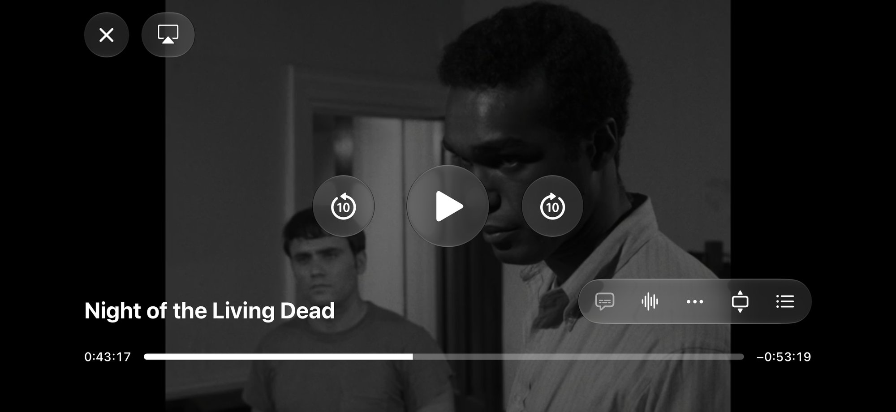
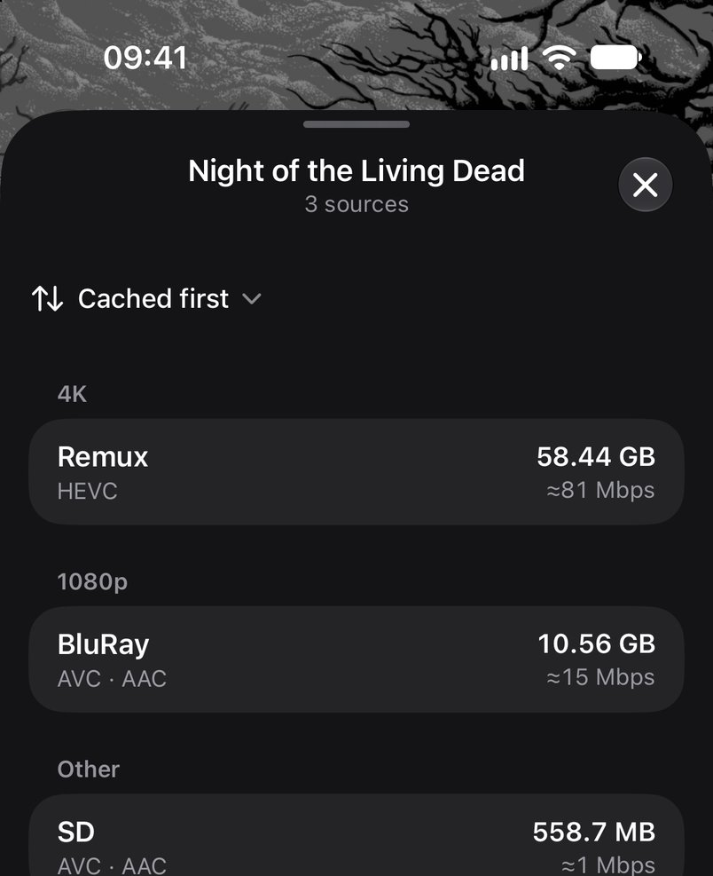
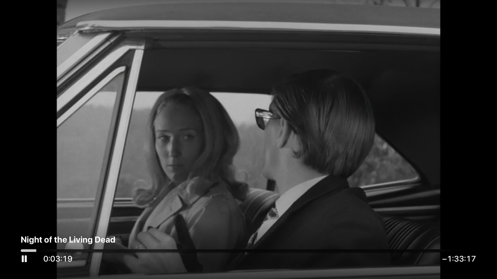

# App screenshots

[Back to loge](../../README.md)

Real app captures, not mockups. They only show *Night of the Living Dead* (1968),
which is in the public domain, played from the Internet Archive's own copies
(`notld-4k-uhd-remux`, `night-of-the-living-dead_1968`) through a local throwaway
addon that listed only those three files. None contains addon URLs or account
secrets.

`iphone-player.jpg` and `iphone-sources.jpg` were captured on **10 November 2026** on an
**iPhone 18 Pro simulator / iOS 27.2** (English UK region). The sources sheet is cropped
to its list, leaving out the title artwork behind it.

`tv-player.jpg` was captured the same day on an **Apple TV 4K (4th generation)
simulator / tvOS 27.2**, driven with `UITests/RemoteDriverTests.swift` and resized
from 4K.

The project page at loge.tjh.li uses web-sized copies of these in `web/images`.

## Updating these images

- Show only public-domain or self-made material. Posters, backdrops, logos and
  portraits of real titles are copyrighted, so keep them out of frame, including
  artwork behind sheets and in catalog rows.
- Use deterministic fixtures, never private setup fields or addon URLs.
- Show the real screen at a readable size; keep aspect ratio and alt text.
- Update the device, OS, date and source notes when replacing a capture.
